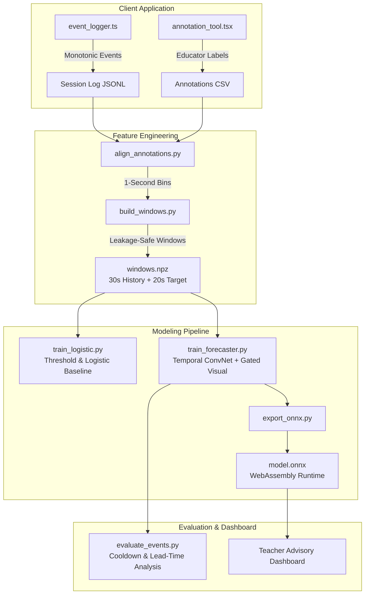

# Component 3: Participation Forecasting (PBEF)

> **Personalized Behavioral and Educational Framework (PBEF) — Component 3**  
> *Development, Research Formulation, and PP1 Milestone Guide*  
> **Target Date:** October 2026 | **Author:** Component Owner

---

## 1. Project Overview

Component 3 (Participation Forecasting) forecasts a **teacher-defined decrease in task participation** within the upcoming **20 seconds** from recent interaction history (~30 seconds).

```
Interaction History (30s)               Forecast Horizon (20s)
[ t - 30s ---------------------> t ]    [ t ------------------> t + 20s ]
  • Response delays                       • Binary onset probability
  • Touch coordinates                     • Current participation state
  • Pauses & hesitation                   • Modality validity & confidence
  • Hints & prompts
  • Optional camera features (masked)
```

### 1.1 What the Prediction Means (Ethical Boundaries)
- **Observable Participation Only:** The model predicts behavioral interaction patterns, **NOT** internal mental, affective, or diagnostic states. It cannot determine if a child is bored, overwhelmed, or distressed.
- **Non-Punitive Design:** Looking away, processing pauses, or self-regulatory motor behaviors (e.g., stimming, rhythmic rocking) must **never** be defined as disengagement.
- **Teacher Advisory Boundary:** Component 3 provides risk and confidence scores to a teacher dashboard; it **never** automatically triggers interventions or overrides teacher autonomy.

---

## 2. System Architecture

The forecasting pipeline combines interaction dynamics with optional masked visual cues and personalized baseline calibration:



### Key Architectural Modules:
1. **Interaction Temporal Convolutional Encoder:** 2-layer 1D ConvNet (32 channels) capturing fine-grained sequence dynamics across the 30-second window.
2. **Optional Visual Temporal Encoder:** 1D ConvNet (16 channels) processing head-pose and face presence when available.
3. **Multimodal Reliability Gate:** Suppresses camera embeddings when visual inputs are masked, corrupted, or absent, guaranteeing robust interaction-only fallback.
4. **Personal Baseline Normalization:** Normalizes interaction latencies relative to learner-specific baseline calibration from the first 60–90 seconds of active engagement.
5. **Dual Output Heads:**
   - **Head 1 (Forecast):** 20-second future onset prediction ($\hat{y} \in [0, 1]$).
   - **Head 2 (State):** Current 5-second participation state classification (`ACTIVE`, `PASSIVE_DECREASE`, `REGULATING`).

---

## 3. Directory Layout

```
PBEF/
├── app/
│   └── src/
│       ├── event_logger.ts       # Monotonic client interaction logger
│       └── annotation_tool.tsx   # Educator 5s window & onset annotation tool
├── configs/                      # Experiment and architecture hyperparameters
├── data/
│   ├── raw/                      # Confidential raw records (never committed)
│   ├── processed/                # Aligned time-series and window tensors
│   └── synthetic/                # Documented test fixtures for pipeline verification
├── docs/
│   ├── DATA_CONTRACT.md          # Input/output schemas and event formats
│   ├── OBSERVABLE_LABELS.md      # Educator behavioral criteria & protocol
│   └── IMPLEMENTATION_CHECKLIST.md # 18-task project tracking log
├── models/                       # Local model checkpoints (.pt, .onnx, .pkl)
├── results/
│   ├── figures/                  # PR curves, confusion matrices, timelines
│   └── metrics/                  # Evaluation summaries (JSON)
├── src/
│   ├── evaluation/
│   │   └── evaluate_events.py    # Event-level precision, recall, and false alerts
│   ├── features/
│   │   ├── align_annotations.py  # 1-second bin alignment
│   │   ├── build_windows.py      # Non-leaking 30s-to-20s window generation
│   │   └── generate_sample_sessions.py # Verification fixture synthesizer
│   └── models/
│       ├── export_onnx.py        # ONNX export and parity validator
│       ├── train_forecaster.py   # PyTorch TCN dual-head forecaster
│       └── train_logistic.py     # Summary-statistic baseline & threshold rules
├── tests/                        # Automated unit and integration tests
├── .gitignore                    # Ignore virtualenvs, raw data, checkpoints
├── README.md                     # Project documentation
└── requirements.txt              # Pinned Python package dependencies
```

---

## 4. Setup & Environment

### 4.1 Prerequisites
- **Python:** 3.11, 3.12, or 3.13 (verified on Python 3.13.1)
- **Node.js:** v18+ (verified on Node.js v22.14.0, npm 10.9.2)
- **Git:** 2.40+ (verified on Git 2.45.1)
- **OS:** Windows (PowerShell) / Linux / macOS

### 4.2 Installation

1. **Clone or navigate to the repository:**
   ```powershell
   cd E:\PBEF
   ```

2. **Activate the virtual environment:**
   ```powershell
   # If script execution is disabled in PowerShell:
   Set-ExecutionPolicy -Scope Process -ExecutionPolicy Bypass
   .\.venv\Scripts\Activate.ps1
   ```

3. **Install pinned dependencies:**
   ```powershell
   python -m pip install --upgrade pip
   pip install -r requirements.txt
   ```

4. **Verify package versions:**
   ```powershell
   python -c "import numpy, pandas, sklearn, torch, onnx, onnxruntime; print('Environment healthy!')"
   ```

---

## 5. End-to-End Pipeline Execution

You can run the complete pipeline using the documented verification fixtures:

### Step 1: Synthesize Verification Sessions
Generates sample interaction logs with aligned annotations and interventions:
```powershell
python src/features/generate_sample_sessions.py --num_learners 3 --sessions_per_learner 3 --output_dir data/synthetic
```

### Step 2: Align Asynchronous Events to 1-Second Bins
Aligns interaction events with educator state labels:
```powershell
python src/features/align_annotations.py `
  --events_file data/synthetic/raw_events_S001_01.jsonl `
  --annotations_file data/synthetic/annotations_S001_01.csv `
  --interventions_file data/synthetic/interventions_S001_01.csv `
  --output_file data/synthetic/aligned_S001_01.csv
```

### Step 3: Build Leakage-Safe Sequence Windows
Creates 30-second input histories with 20-second future targets:
```powershell
python src/features/build_windows.py `
  --aligned_file data/synthetic/aligned_S001_01.csv `
  --output_dir data/synthetic
```

### Step 4: Train Baseline Models
Fits heuristic threshold rules and summary-statistic logistic regression:
```powershell
python src/models/train_logistic.py `
  --data_file data/synthetic/windows.npz `
  --manifest_file data/synthetic/window_manifest.csv `
  --output_dir models/baseline
```

### Step 5: Train Temporal Convolutional Forecaster
Trains the PyTorch TCN with dual heads and reliability gating:
```powershell
python src/models/train_forecaster.py `
  --data_file data/synthetic/windows.npz `
  --manifest_file data/synthetic/window_manifest.csv `
  --output_dir models/tcn_forecaster `
  --epochs 20
```

### Step 6: Event-Level Evaluation with Cooldown
Calculates true precision, recall, false alerts per hour, and lead times:
```powershell
python src/evaluation/evaluate_events.py `
  --manifest_file data/synthetic/window_manifest.csv `
  --predictions_file models/tcn_forecaster/predictions.npy `
  --threshold 0.50 `
  --cooldown_sec 15
```

### Step 7: Export to ONNX for Browser Inference
Exports the PyTorch model to ONNX and verifies numerical parity:
```powershell
python src/models/export_onnx.py `
  --checkpoint_file models/tcn_forecaster/model.pt `
  --output_onnx models/tcn_forecaster/model.onnx
```

---

## 6. PP1 Evidence & Deliverables

For the **Project Presentation 1 (PP1)** viva defense, the following artifacts must be demonstrated:
1. **Observable Label Protocol:** Confirmed behavioral criteria distinguishing disengagement from self-regulation ([`docs/OBSERVABLE_LABELS.md`](docs/OBSERVABLE_LABELS.md)).
2. **Synchronized Event Logger:** Verified monotonic client-side logging ([`app/src/event_logger.ts`](app/src/event_logger.ts)).
3. **Dataset Transparency Audit:** Explicit breakdown of public, proxy, and synthetic data (never claiming synthetic data validates real-world clinical effectiveness).
4. **Baseline Benchmark:** Transparent logistic regression & threshold rules establishing initial performance bounds before deep learning.
5. **False Alert Budget Analysis:** Evaluation of false alerts per hour (< 3.0/hr) with alert cooldown suppression to prevent educator fatigue.
6. **Browser Inference Parity:** Validated ONNX export operating in real-time under WebAssembly.

---

## 7. Data Ethics & Governance

- **Pseudonymization:** All learners are assigned anonymous IDs (`L001`, `L002`). Identifiable information must never be recorded.
- **Access Control:** Real participant interaction logs in `data/raw/` are strictly excluded from version control via `.gitignore`.
- **Institutional Compliance:** Data collection with learners or adult proxies requires institutional ethical review and ongoing assent.
